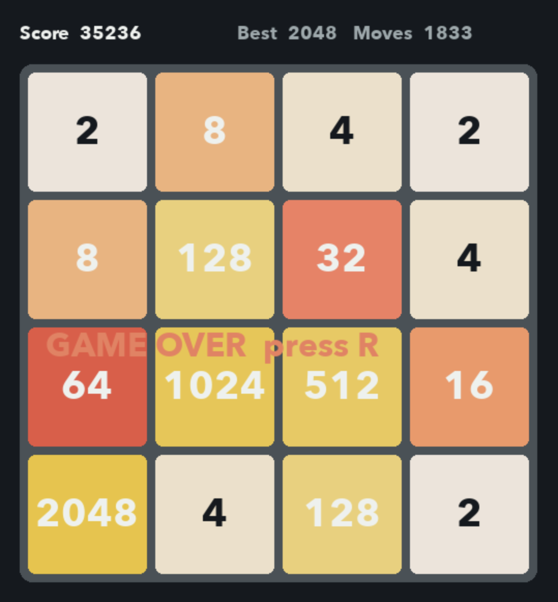

# 2048 AI: DQN, Search, and Heuristic Agents

A NumPy implementation of 2048 with reinforcement learning, hand-coded policies, reproducible evaluation tools, and a Pygame AI Arena. The project includes five playable agents, several saved DQN checkpoints, and per-game evaluation artifacts.

## AI Arena

The Arena lets you select an agent, watch it play, and inspect its decisions and diagnostics.

```bash
python visualize_arena.py
```

The Arena starts paused. Click an agent in the left panel, then use:

| Key | Action |
| --- | --- |
| `Space` | Play or pause |
| `S` | Advance one move while paused |
| `R` | Reset the game |
| `D` | Show or hide extra diagnostics |
| `+` / `-` | Increase or decrease playback speed |
| `[` / `]` | Decrease or increase Expectimax depth (1–3) |
| `Esc` | Quit |

Expectimax uses depth 2 by default. Set another initial depth with `python visualize_arena.py --depth 1` (or another positive integer); the Arena controls adjust it within depths 1–3. DQN and Strategy V1 require their checkpoint files. The Arena displays a model as unavailable if its checkpoint is absent or incompatible; it does not substitute another model.

### Arena screenshot



*Example game played by the Expectimax agent: score 35,236, best tile 2048, after 1,833 moves. This is a single game, not an average or benchmark result.*

## Agents

| Agent | Approach | Key distinction |
| --- | --- | --- |
| Greedy Heuristic | Tries each legal move and selects the resulting board with the highest `strategy_score` | One-step choice; evaluates before the random spawn |
| Expectimax | Searches player moves and averages over random tile spawns | Depth 2 by default; chance nodes place a 2 (90%) or 4 (10%) uniformly in an empty cell |
| Original Dueling Double DQN | Learned action values from the shaped-reward training configuration | Dueling network, Double DQN targets, legal-action masking |
| Raw-Score Dueling DQN | Same Dueling Double DQN algorithm trained with merge points as reward | Alternative reward mode; no comparative performance claim is made here |
| Strategy V1 DQN | Legacy feedforward DQN checkpoint with legal-action masking at inference | Its action-index mapping is assumed from the current game ordering and remains unverified |

The greedy and Expectimax agents use the shared board strategy score. It rewards empty cells, snake ordering of larger tiles, monotonic rows and columns, and keeping the largest tile in the bottom-left corner. Expectimax evaluates each legal move, then averages the leaf heuristic over every empty-cell location and both possible spawned tiles. Its depth counts player moves, with a chance spawn after each move. Search does not advance the live game's random number generator.

## Install

Python 3.10 or newer is recommended. Create and activate a virtual environment, then install the dependencies:

```bash
python3 -m venv .venv
source .venv/bin/activate        # macOS/Linux
# Windows PowerShell: .venv\Scripts\Activate.ps1
python -m pip install --upgrade pip
python -m pip install -r requirements.txt
```

The listed runtime dependencies are NumPy, PyTorch, Pygame, and Matplotlib. The test suite uses pytest; install it separately with `python -m pip install pytest` if it is not already available. The DQN selects CUDA when PyTorch reports it available and otherwise uses CPU.

## Play and train

Run a trained DQN in the single-agent visualizer:

```bash
python play.py --checkpoint checkpoints_dueling/best_dqn_2048.pt
```

The original `play.py` controls are `Space` to pause, `+`/`-` to change speed, `R` to restart, and `Esc` to quit.

Train the shaped-reward Dueling Double DQN (default: 5,000 episodes):

```bash
python train.py --episodes 5000
```

The default output is `checkpoints_dueling/`. For raw score reward, select a separate output folder:

```bash
python train.py --episodes 5000 --reward-mode raw_score
```

Training refuses to overwrite a pre-existing output directory unless resuming. To resume, point `--resume` to a checkpoint in the selected output directory; `--episodes` specifies additional episodes. Use `--out PATH` to select a new output directory. Checkpoints and training logs are generated locally and excluded from Git.

### DQN implementation

The current `agent.py` encodes the 4×4 board as 16 values: empty cells are zero and other tiles are `log2(tile) / 16`. The Dueling Q-network has a shared `16 → 256 → 256` ReLU feature network, then separate value (`256 → 128 → 1`) and advantage (`256 → 128 → 4`) streams. It combines them as `V + A - mean(A)`.

Training uses Double DQN: the online network selects a next legal action and the target network evaluates it. A 100,000-transition replay buffer stores next-action masks; batches contain 128 samples by default. The optimizer is Adam (learning rate `3e-4`), discount is `0.99`, target weights update every 1,000 learning steps, the loss is smooth L1, and gradients are clipped to norm 10. Epsilon-greedy exploration decays after each episode to a minimum of `0.05` by default. The shaped reward combines merge reward, a small move penalty, strategy-score change, and a terminal penalty; `raw_score` instead rewards merge points.

## Evaluation

The canonical evaluator turns exploration off and records one row per game, including seed, score, maximum tile, and moves. A seed reproduces the initial board. The environment uses one random stream for later tile spawns, so different policies can consume different portions of that stream after their move histories diverge. Matching seeds therefore do not guarantee identical later spawns across agents. Use the same game seeds and move cap for meaningful comparisons.

The saved depth-2 Expectimax evaluation used 100 games, seeds 1000–1099, and a 5,000-move cap. The verified artifacts are [`summary.json`](results/canonical/expectimax_depth_2_seeds/summary.json) and [`games.csv`](results/canonical/expectimax_depth_2_seeds/games.csv):

| Metric | Result |
| --- | ---: |
| Games | 100 |
| Mean score | 14,450.44 |
| Median score | 13,516 |
| Score standard deviation (population) | 8,641.40 |
| Reached 2048 | 15% |
| Reached 1024 or higher | 57% |
| Mean moves | 860 |

These 100 Expectimax games do not establish that Expectimax outperforms any other agent. The other agents need comparable evaluations under the same protocol before drawing that conclusion. Do not infer their results from the Arena or from their checkpoint names.

To reproduce the saved Expectimax protocol without replacing its existing files, write to a new output directory:

```bash
python evaluate_expectimax.py --depth 2 --games 100 --seed 1000 --max-moves 5000 --output-dir results/reproduced/expectimax_depth_2
```

Comparable commands for other agents also use distinct output directories:

```bash
python evaluate_heuristic.py --games 100 --seed 1000 --max-moves 5000 --output-dir results/reproduced/heuristic
python evaluate.py --checkpoint checkpoints_dueling/best_dqn_2048.pt --games 100 --seed 1000 --max-moves 5000 --output-dir results/reproduced/dueling
python evaluate.py --checkpoint checkpoints_dueling_raw_score/best_dqn_2048.pt --games 100 --seed 1000 --max-moves 5000 --output-dir results/reproduced/raw_score
python evaluate_legacy.py --checkpoint backups/strategy_dqn_v1.pt --games 100 --seed 1000 --max-moves 5000 --output-dir results/reproduced/strategy_v1
```

These commands require the relevant checkpoint files. Evaluation writes `games.csv` and `summary.json` under the selected output directory. The DQN commands use `evaluate.py`; the other scripts provide policies specific to Expectimax, the heuristic, and legacy Strategy V1.

## Tests

Run the existing suite with:

```bash
python -m pytest -q
```

## Limitations and next steps

- Expectimax can become slow as depth grows because it expands possible spawn cells and tile values.
- The Strategy V1 checkpoint does not record action labels, so the current action mapping is an unverified assumption.
- The DQN results are stochastic and no claim is made that either DQN variant is stronger than the other agents.
- Add matched multi-seed evaluations for all agents before making performance comparisons.
- Consider adding a screenshot or short Arena GIF and documenting the environment and Python versions used for a release.
